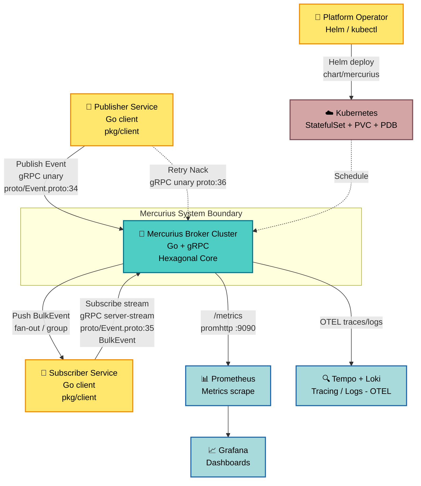
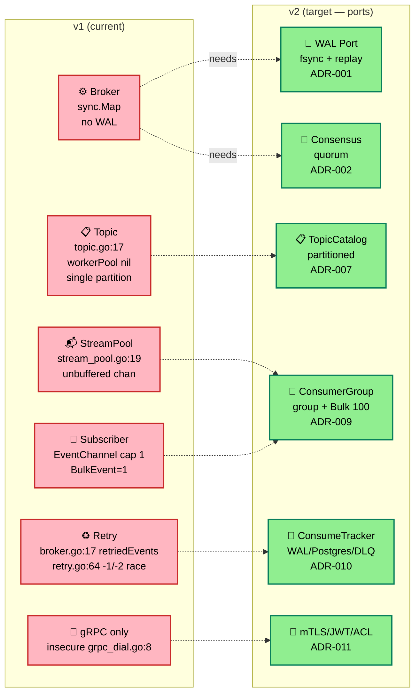
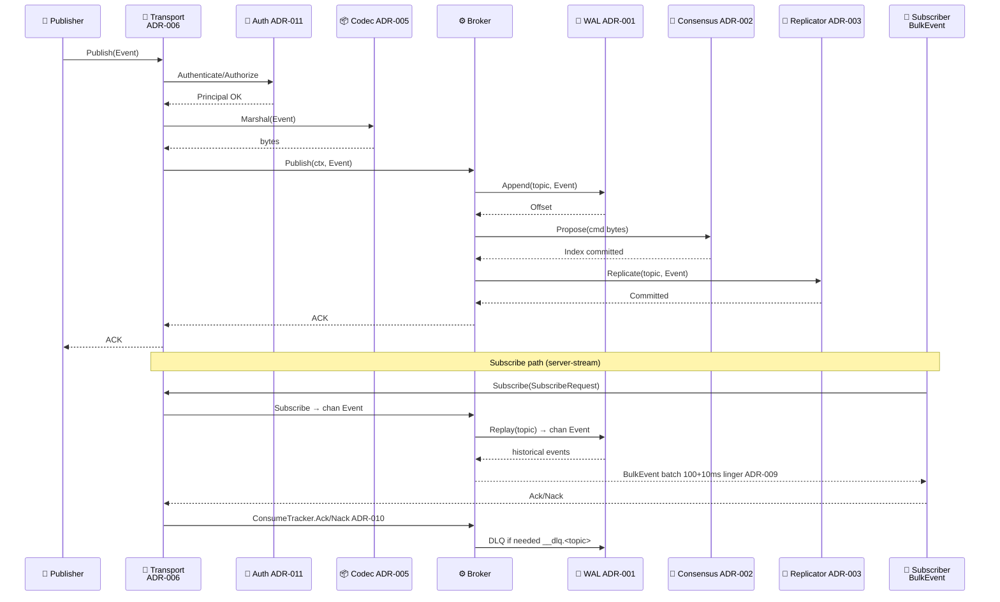
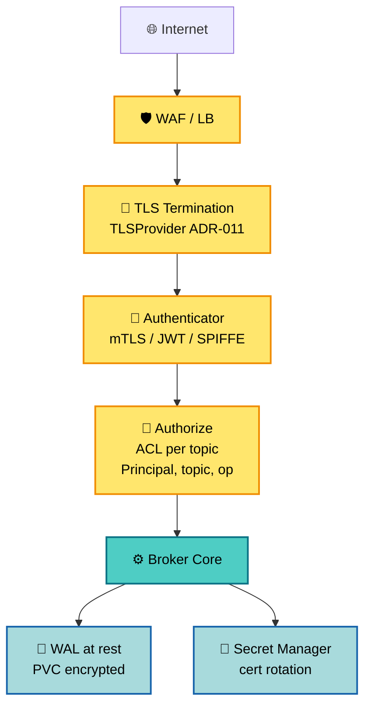
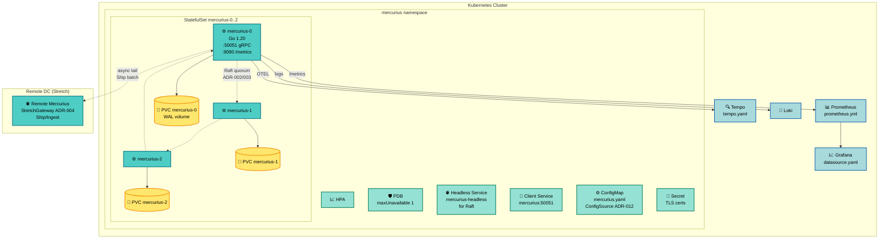

# Mercurius — System / Component Architecture

**Author:** @ispiroglu  
**Date:** 2026-08-21  
**Status:** Approved (v2 traceable)  
**Version:** 2.0 — Port/Interface Traceable  
**Related:** `docs/v2/PORTS.md`, `docs/v2/ADR-*.md`, `docs/v2/01-concepts-overview.md`

---

## 1. Executive Summary

Mercurius is a **Go + gRPC pub/sub message broker** using topic-based, dynamic fan-out with at-least-once aspirations. v1 is a single-node, in-memory PoC (`sync.Map`, no WAL, no replication). v2 is a **from-scratch, zero-ready-deps rewrite** structured as a **hexagonal (Ports & Adapters)** system where **every decidable point is a `Port` interface** (`internal/port/*.go`) — each ADR is exactly “which adapter implements this port”.

**Business Context:**
- Problem: lightweight, self-hostable alternative to Kafka/RabbitMQ for service-to-service messaging with replication and at-least-once semantics.
- Users: Go microservices publishing/subscribing via gRPC (`Publish / Subscribe(stream BulkEvent) / Retry`).
- Requirements: dynamic topics, broker replication & failover, immutable messages, delivery tracking/DLQ, mTLS/JWT, K8s operability, OTEL observability.

**Key Decisions (traceable):**
- Hexagonal core — `internal/broker` imports only `internal/port/*`, never adapters (`PORTS.md` Rule 1) → `ADR-001..014`
- 14 ports / 14 ADRs: WAL, Consensus, Replicator, StretchGateway, Codec, Transport, TopicCatalog, DeliveryGuarantee, ConsumerGroup, ConsumeTracker, Authenticator, ConfigSource, Metrics, TestCluster
- From-scratch policy: every `Alternatifler` table lists a `from-scratch` adapter with LOC/weeks cost

---

## 2. System Context (C4 Level 1)



**Stakeholders:**

| Stakeholder | Role | Interest |
|-------------|------|----------|
| Service Developer | Publisher/Subscriber | Low latency, ordered delivery, simple gRPC API |
| Platform Team | Operator | K8s deploy, PVC durability, PDB availability, OTEL |
| Security | Compliance | mTLS / JWT, per-topic ACL, SPIFFE |
| QA / Chaos | Test | TestCluster port — partition/corruption harness |

---

## 3. Requirements

### 3.1 Functional

| ID | Requirement | Priority | Port / ADR |
|----|-------------|----------|------------|
| FR-1 | Publish immutable Event to dynamic topic | High | WAL ADR-001 + TopicCatalog ADR-007 |
| FR-2 | Subscribe with replay + live tail | High | Transport ADR-006 + WAL |
| FR-3 | Consumer groups & partition assignment | High | ConsumerGroup ADR-009 |
| FR-4 | Ack/Nack, retry, DLQ, trace | High | ConsumeTracker ADR-010 + Delivery ADR-008 |
| FR-5 | Multi-broker replication & quorum | High | Consensus ADR-002 + Replicator ADR-003 |
| FR-6 | Multi-DC stretch (ship/ingest/failover) | Medium | StretchGateway ADR-004 |
| FR-7 | Exactly/at-least/at-most delivery | High | DeliveryGuarantee ADR-008 |

### 3.2 Non-Functional

| Category | Requirement | Target | Port / ADR |
|----------|-------------|--------|------------|
| Durability | fsync on WAL before ACK | p99 fsync <5ms | WAL ADR-001 |
| Throughput | BulkEvent batch 100 + 10ms linger | >50k msg/s | ConsumerGroup ADR-009 |
| Availability | N=3, W=2 R=2, PDB | 99.9% | Replicator ADR-003 + Operability ADR-012 |
| Security | mTLS + per-topic ACL | SPIFFE optional | Authenticator ADR-011 |
| Observability | OTEL traces + Prom metrics + Loki | Grafana + Tempo | Metrics ADR-013 |
| Deploy | Helm StatefulSet + headless + PVC | Zero-downtime | ConfigSource ADR-012 |
| Test | Partition/corruption chaos | buf breaking | TestCluster ADR-014 |

---

## 4. Architecture Overview

### 4.1 Style — Hexagonal (Ports & Adapters)

**Why:**
- Every decidable point is an interface → ADRs are adapter choices, traceable via `PORTS.md`
- Core (`Broker`) never imports adapter — `adapter → port → core` direction
- From-scratch adapters swappable without core changes; mocks for unit tests
- `internal/*` owns ≤1 port, no adapter type leaks (`*pebble.DB` never crosses port)

### 4.2 High-Level — Containers (C4 Level 2)

```mermaid
graph TB
    Publisher[👤 Publisher<br/>pkg/client<br/>grpc_dial.go insecure*]
    Subscriber[👤 Subscriber<br/>pkg/client<br/>BulkEvent cap 1]

    subgraph "Mercurius Cluster (v2 target)"
        Gateway[🚪 gRPC Gateway<br/>internal/server<br/>Transport Port ADR-006<br/>:50051]
        BrokerCore[⚙️ Broker Core<br/>internal/broker<br/>Broker{TopicRepository, retriedEvents}*<br/>*v1 leak → ports]
        WAL[💾 WAL<br/>internal/port/wal.go ADR-001<br/>Pebble/Badger/RocksDB/from-scratch]
        Consensus[🔄 Consensus<br/>port/consensus.go ADR-002<br/>Raft/Multi-Paxos/Zab/VR/EPaxos]
        Replicator[📡 Replicator<br/>port/replication.go ADR-003<br/>global/per-topic/partitioned]
        Stretch[🌐 Stretch Gateway<br/>port/stretch.go ADR-004<br/>Ship/Ingest/Promote/Lag]
        TopicCatalog[📋 TopicCatalog<br/>port/topic.go ADR-007<br/>Create/Get/PartitionFor]
        Delivery[✅ Delivery<br/>port/delivery.go ADR-008<br/>Guarantee + Deduplicator]
        ConsumerG[👥 ConsumerGroup<br/>port/consumer.go ADR-009<br/>Join/Leave/Assignment/Next]
        Tracker[📝 ConsumeTracker<br/>port/consume.go ADR-010<br/>Ack/Nack/DLQ/Trace]
        Auth[🔐 Auth<br/>port/auth.go ADR-011<br/>Authenticator + TLSProvider]
        Config[⚙️ Config<br/>port/config.go ADR-012<br/>Load/Watch Helm]
        Metrics[📊 Metrics<br/>port/metrics.go ADR-013<br/>OTEL + Prom]
    end

    Codec[📦 Codec<br/>port/codec.go ADR-005<br/>protobuf/flatbuffers/gob/JSON<br/>offset+partition+producer_id+dc_id]

    Publisher -->|Publish| Gateway
    Subscriber -->|Subscribe stream| Gateway
    Subscriber -.->|Retry| Gateway
    Gateway -->|Publish ctx| BrokerCore
    Gateway -.->|uses| Codec
    BrokerCore -->|Append/Read/Replay| WAL
    BrokerCore -->|Propose/Leader| Consensus
    BrokerCore -->|Replicate/Committed| Replicator
    Replicator -.->|uses| Consensus
    BrokerCore -->|Ship/Ingest| Stretch
    BrokerCore -->|PartitionFor| TopicCatalog
    BrokerCore -->|Guarantee/Seen| Delivery
    BrokerCore -->|Assignment/Next| ConsumerG
    BrokerCore -->|Ack/Nack/DLQ| Tracker
    Gateway -->|Authenticate/Authorize| Auth
    BrokerCore -.->|Load/Watch| Config
    BrokerCore -.->|IncCounter/Observe| Metrics

    Prometheus[📊 Prometheus] -.->|scrape| Metrics
    Tempo[🔍 Tempo] -.->|OTEL| Metrics

    classDef core fill:#4ECDC4,stroke:#0B7285,stroke-width:2px,color:#000
    classDef port fill:#FFE66D,stroke:#F08C00,stroke-width:2px,color:#000
    classDef infra fill:#95E1D3,stroke:#087F5B,stroke-width:2px,color:#000
    classDef actor fill:#FFE66D,stroke:#F08C00,stroke-width:2px,color:#000

    class BrokerCore core
    class Gateway,WAL,Consensus,Replicator,Stretch,TopicCatalog,Delivery,ConsumerG,Tracker,Auth,Config,Metrics,Codec port
    class Prometheus,Tempo infra
    class Publisher,Subscriber actor
```

> **v1 leak → port mapping:** `Broker.sync.Map` → WAL ADR-001; single-node → Consensus ADR-002; `Topic.PublishEvent select/default drop` → Replicator ADR-003 + Delivery ADR-008; `workerPool nil`/`BulkEvent=1` → TopicCatalog ADR-007 + ConsumerGroup ADR-009; `retriedEvents sync.Map` race → ConsumeTracker ADR-010; `grpc_dial.go:8 insecure` → Auth ADR-011; `promhttp :40` only → Metrics ADR-013.

---

## 5. Component Design — Hexagonal Core & 14 Ports

### 5.1 Hexagon (C4 Level 3 — Component)

```mermaid
graph TB
    subgraph "Driving Side — Outside → Ports"
        PubClient[👤 Go Publisher<br/>pkg/client]
        SubClient[👤 Go Subscriber<br/>pkg/client]
        K8sAdmin[☁️ Helm / kubectl<br/>ConfigSource]
        ChaosTest[🧪 TestCluster<br/>port/testkit.go ADR-014<br/>Leader/Kill/Partition/CorruptWAL]
    end

    subgraph "Hexagon — internal/broker (Core)"
        direction TB
        subgraph "Inbound Ports (driven by outside)"
            PTrans[🔌 Transport<br/>port/transport.go ADR-006<br/>Publish/Subscribe/Retry]
            PCodec[🔌 Codec<br/>port/codec.go ADR-005<br/>Marshal/Unmarshal/Name]
            PAuth[🔌 Auth<br/>port/auth.go ADR-011<br/>Authenticate/Authorize<br/>TLSProvider]
        end
        subgraph "Domain Core"
            Broker[⚙️ Broker<br/>findOrInsertTopic<br/>PublishEvent / Subscribe<br/>*TopicRepository]
            TopicRepo[📋 TopicRepository]
            SubRepo[👥 SubscriberRepository]
            DomainEvent[📨 Event<br/>id/topic/body/createdAt<br/>+offset/partition/producer_id/dc_id*]
        end
        subgraph "Outbound Ports (core → adapters)"
            PWAL[🔌 WAL ADR-001<br/>Append/Read/Replay/Sync/Close]
            PCons[🔌 Consensus ADR-002<br/>Propose/ReadIndex/AddVoter/Leader]
            PRepl[🔌 Replicator ADR-003<br/>Replicate/Committed/Topology]
            PStretch[🔌 StretchGateway ADR-004<br/>Ship/Ingest/Promote/Lag]
            PTopic[🔌 TopicCatalog ADR-007<br/>Create/Get/List/PartitionFor]
            PDeliv[🔌 Delivery ADR-008<br/>Guarantee + Seen/Mark]
            PGroup[🔌 ConsumerGroup ADR-009<br/>Join/Leave/Assignment/Next]
            PTrack[🔌 ConsumeTracker ADR-010<br/>Ack/Nack/DLQ/Trace]
            PConf[🔌 ConfigSource ADR-012<br/>Load/Watch]
            PMet[🔌 Metrics ADR-013<br/>IncCounter/ObserveHistogram<br/>Tracer.Start]
        end
    end

    subgraph "Driven Side — Adapters (implement ports)"
        direction TB
        AWALa[💾 Pebble LSM<br/>adapter]
        AWALb[📦 BadgerDB]
        AWALc[🧱 RocksDB/grocksdb]
        AWALd[📝 from-scratch<br/>file+CRC+fsync]

        AConsA[🔄 Raft<br/>etcd/raft]
        AConsB[🔀 Multi-Paxos]
        AConsC[♻️ Zab / VR / EPaxos]

        AReplA[📡 Global log]
        AReplB[📋 Per-topic]
        AReplC[🔢 Partitioned hash]

        ATransA[🚪 gRPC server-stream<br/>Event.proto:34-36]
        ATransB[🔌 gRPC bidi / QUIC / rawTCP]

        AAuthA[🔐 mTLS]
        AAuthB[🎫 JWT / ACL / SPIFFE]

        AObsA[📊 OTEL+Tempo+Prom+Grafana+Loki]
        ATestA[🧪 testcontainers-go<br/>kind+helm / toxiproxy+pumba]
    end

    PubClient -->|Publish Event| PTrans
    SubClient -->|Subscribe| PTrans
    PubClient -.->|Encode| PCodec
    PTrans -->|Auth| PAuth
    PTrans --> Broker
    PCodec -.-> DomainEvent
    Broker --> TopicRepo
    Broker --> SubRepo
    Broker --> DomainEvent

    Broker --> PWAL
    Broker --> PCons
    Broker --> PRepl
    Broker --> PStretch
    Broker --> PTopic
    Broker --> PDeliv
    Broker --> PGroup
    Broker --> PTrack
    Broker -.-> PConf
    Broker -.-> PMet
    ChaosTest -.->|Kill/Partition| PCons

    PWAL -.->|implements| AWALa
    PWAL -.->|implements| AWALb
    PWAL -.->|implements| AWALc
    PWAL -.->|implements| AWALd

    PCons -.-> AConsA
    PCons -.-> AConsB
    PCons -.-> AConsC

    PRepl -.-> AReplA
    PRepl -.-> AReplB
    PRepl -.-> AReplC

    PTrans -.-> ATransA
    PTrans -.-> ATransB
    PAuth -.-> AAuthA
    PAuth -.-> AAuthB
    PMet -.-> AObsA
    ChaosTest -.-> ATestA

    classDef driving fill:#FFE66D,stroke:#F08C00,stroke-width:2px,color:#000
    classDef port fill:#F38181,stroke:#C92A2A,stroke-width:2px,color:#fff
    classDef core fill:#4ECDC4,stroke:#0B7285,stroke-width:2px,color:#000
    classDef adapter fill:#95E1D3,stroke:#087F5B,stroke-width:2px,color:#000
    classDef domain fill:#E6E6FA,stroke:#1864AB,stroke-width:2px,color:#000

    class PubClient,SubClient,K8sAdmin,ChaosTest driving
    class PTrans,PCodec,PAuth,PWAL,PCons,PRepl,PStretch,PTopic,PDeliv,PGroup,PTrack,PConf,PMet port
    class Broker,TopicRepo,SubRepo core
    class DomainEvent domain
    class AWALa,AWALb,AWALc,AWALd,AConsA,AConsB,AConsC,AReplA,AReplB,AReplC,ATransA,ATransB,AAuthA,AAuthB,AObsA,ATestA adapter
```



**Dependency rule:** `Driving Adapters → Inbound Ports → Core → Outbound Ports → Driven Adapters`. Core imports `internal/port/*` only. Example `WAL` never returns `*pebble.DB`; `Consensus` never exposes WAL.

### 5.2 Port Map (traceable)

| # | Port | Interface | ADR | Scope owns | NOT owns | Key Adapters |
|---|------|-----------|-----|------------|----------|--------------|
| 1 | WAL | `internal/port/wal.go: WAL` | ADR-001 | segment/CRC/fsync/replay | index/cache, Consensus | Pebble, Badger, RocksDB, Kafka segment, from-scratch 1500 LOC 3-4w |
| 2 | Consensus | `consensus.go: Consensus` | ADR-002 | term/leader/quorum | WAL, Replicator | Raft, Multi-Paxos, Zab, VR, EPaxos, from-scratch Raft 3000 LOC 6-8w |
| 3 | Replicator | `replication.go: Replicator` | ADR-003 | log distribution | Consensus algo | global, per-topic, partitioned hash, W2R2N3 |
| 4 | StretchGateway | `stretch.go: StretchGateway` | ADR-004 | inter-DC ship/ingest/Promote/Lag | intra-DC quorum | async tailer, active-active VC, per-DC quorum, Raft ship |
| 5 | Codec | `codec.go: Codec` | ADR-005 | Event serialization (breaking: offset/partition/producer_id/dc_id) | transport | protobuf Event.proto:1-31, flatbuffers, capnproto, gob serialize.go:5, JSON |
| 6 | Transport | `transport.go: Transport` | ADR-006 | RPC framing/keepalive/flow | business logic | gRPC server-stream 34-36, bidi, QUIC, raw TCP, WebSocket |
| 7 | TopicCatalog | `topic.go: TopicCatalog` | ADR-007 | topic lifecycle/PartitionFor | WAL | single (v1 topic.go:17), hash, range, dynamic auto-split |
| 8 | Delivery | `delivery.go: DeliveryGuarantee+Deduplicator` | ADR-008 | guarantee/idempotency | ConsumerGroup | at-most-once drop topic.go:29, at-least, exactly-once, LWW vs VC |
| 9 | ConsumerGroup | `consumer.go: ConsumerGroup` | ADR-009 | group Join/Leave/Assignment/Next | delivery | fan-out StreamPool:9, Kafka group, exclusive, Push/Pull/Hybrid, BulkEvent 1→100+10ms |
| 10 | ConsumeTracker | `consume.go: ConsumeTracker` | ADR-010 | Ack/Nack/DLQ/Trace | backoff | memory broker.go:17 retriedEvents, WAL-backed, Postgres, SQLite WAL, `__dlq.<topic>` |
| 11 | Auth | `auth.go: Authenticator+TLSProvider` | ADR-011 | authn/authz/TLS | transport | mTLS, JWT, ACL, insecure grpc_dial.go:8, SPIFFE |
| 12 | ConfigSource | `config.go: ConfigSource` | ADR-012 | config Load/Watch, deploy | observability | Helm StatefulSet+PVC+PDB+Headless `chart/mercurius/`, Kustomize, Operator, systemd, Compose |
| 13 | Metrics | `metrics.go: Metrics+Tracer` | ADR-013 | emission IncCounter/Observe/SetGauge, Tracer.Start | collection | OTEL+Tempo+Prom+Grafana+Loki, Prom only, Datadog, promhttp mercurius.go:40 |
| 14 | TestCluster | `testkit.go: TestCluster` | ADR-014 | harness Leader/Kill/Partition/CorruptWAL | production | testcontainers-go, kind+helm, toxiproxy+pumba, rapid, buf breaking |

Full map: `docs/v2/PORTS.md`

### 5.3 Current v1 → Target v2 Gap



---

## 6. Data Architecture

### 6.1 Event Model

```mermaid
erDiagram
    EVENT ||--o{ BULKEVENT : "batched in"
    TOPIC ||--o{ EVENT : contains
    EVENT ||--o{ CONSUME_RECORD : tracked
    CONSUMER_GROUP ||--o{ SUBSCRIBER : members
    TOPIC ||--o{ PARTITION : has

    EVENT {
        string id PK
        string topic FK
        bytes body
        timestamp createdAt
        uint32 expiresAt
        uint64 offset "ADR-005 breaking"
        uint32 partition "ADR-005 breaking"
        string producer_id "ADR-005 breaking"
        string dc_id "ADR-005 breaking"
    }
    BULKEVENT {
        repeated Event eventList
    }
    TOPIC {
        string name PK
        uint32 partitionCount
    }
    PARTITION {
        uint32 id PK
        string topic FK
        uint64 committedOffset
    }
    CONSUME_RECORD {
        string eventID FK
        string subscriberID FK
        string group
        string status "ack/nack/dlq"
        timestamp at
    }
    SUBSCRIBER {
        string id PK
        string name
        string group "ADR-009"
        channel EventChannel
    }
```

### 6.2 Publish / Subscribe Flow



---

## 7. Integration Points

| System | Purpose | Protocol | Port | SLA |
|--------|---------|----------|------|-----|
| Go client `pkg/client` | Publish/Subscribe/Retry | gRPC (proto 34-36) | Transport ADR-006 | 99.9% |
| WAL adapters | Durability | embedded | WAL ADR-001 | fsync <5ms |
| Raft peers | Quorum | gRPC/QUIC | Consensus ADR-002 | leader <1s failover |
| Stretch DC | Inter-DC | gRPC tailer | Stretch ADR-004 | async lag <2s |
| Prometheus / Tempo | Observability | HTTP/OTEL | Metrics ADR-013 | scrape 15s |

---

## 8. Security Architecture



`pkg/client/grpc_dial.go:8 insecure.NewCredentials()` → replaced by `TLSProvider.ServerConfig()/ClientConfig()`.

---

## 9. Deployment Architecture



**Helm layout** (`chart/mercurius/`): `Chart.yaml`, `values.yaml`, `templates/statefulset.yaml`, `service.yaml`, `pdb.yaml`, `configmap.yaml`, `secret.yaml` — see `ADR-012`.

Metrics: `mercurius_publish_total{topic,partition}`, `publish_latency_seconds`, `wal_sync_duration_seconds`, `replication_lag_seconds`, `stretch_lag_seconds{dc}`, `consumer_lag{topic,group,partition}`, `dlq_total` — `ADR-013` table.

---

## 10. Decision Log (ADR Traceability)

Every ADR = one port. No decision is `accepted` — all `proposed` until research complete.

| ADR | Port | Question | Options (Adapters) |
|-----|------|----------|---------------------|
| ADR-001 | WAL | Which persistence? | Pebble / Badger / RocksDB / Kafka segment / from-scratch `3-4w 1500 LOC` |
| ADR-002 | Consensus | Which consensus? | Raft / Multi-Paxos / Zab / VR / EPaxos / from-scratch Raft `6-8w 3000 LOC` |
| ADR-003 | Replicator | Which topology? | global / per-topic / partitioned hash / W2R2N3 |
| ADR-004 | StretchGateway | Which multi-DC? | async tailer / active-active VC / per-DC quorum / Raft ship |
| ADR-005 | Codec | Which wire codec? | protobuf Event.proto:1-31 / flatbuffers / capnproto / gob serialize.go:5 / JSON |
| ADR-006 | Transport | Which RPC? | gRPC server-stream 34-36 / bidi / QUIC / raw TCP / WebSocket |
| ADR-007 | TopicCatalog | Which partitioning? | single topic.go:17 / hash / range / dynamic |
| ADR-008 | Delivery | Which guarantee? | at-most-once drop topic.go:29 / at-least / exactly-once / LWW vs VC |
| ADR-009 | ConsumerGroup | Which consumer model? | fan-out StreamPool:9 / Kafka group / exclusive / Push/Pull/Hybrid / Bulk 1→100+10ms |
| ADR-010 | ConsumeTracker | Which tracking? | memory broker.go:17 / WAL-backed / Postgres / SQLite / `__dlq.<topic>` |
| ADR-011 | Auth | Which auth? | mTLS / JWT / ACL / insecure grpc_dial.go:8 / SPIFFE |
| ADR-012 | ConfigSource | Which deploy? | Helm StatefulSet+PVC+PDB+Headless / Kustomize / Operator / systemd |
| ADR-013 | Metrics | Which observability? | OTEL+Tempo+Prom+Grafana+Loki / Prom only / Datadog / none mercurius.go:40 |
| ADR-014 | TestCluster | Which harness? | testcontainers-go / kind+helm / toxiproxy+pumba / rapid / buf breaking |

Reference: `docs/v2/PORTS.md` (canonical map), `docs/v2/README.md` (14-row table), `docs/v2/ADR-INDEX.md`.

---

## 11. References

- `proto/Event.proto:1-37` — current Event/BulkEvent/SubscribeRequest/RetryRequest + `service Mercurius`
- `internal/broker/{broker,topic,subscriber,stream_pool,retry}.go` — v1 leaks documented in §5.2
- `pkg/client/grpc_dial.go:8` — insecure → TLSProvider
- `pkg/serialize/serialize.go:5` — gob → Codec port
- `cmd/mercurius.go:40` — promhttp → Metrics port
- ADRs: `docs/v2/ADR-001`..`ADR-014` (all `proposed`)
- Concepts: `docs/v2/01-concepts-overview.md`, `02-persistence.md` .. `07-testing-strategy.md`

---

## 12. How to Read

1. Start `docs/v2/PORTS.md` — trace all 14 ports.
2. For any port, open its ADR → `## Port` → `Alternatifler` 6-col table (`Adapter Type`) → no decision yet.
3. This document visualizes the same maps — keep `PORTS.md`/`ADR-INDEX.md`/`ARCHITECTURE.md` in sync.

