# Mercurius v2 — PORTS (Hexagonal Map)

Her ADR bir port'tur, her port bir interface'tir — sistemi bu dosyayı okuyarak izleyebilirsin. Core (`Broker`) hiçbir adapter'ı import etmez; sadece `internal/port/*.go` içindeki port interface'lerine bağımlıdır. Her ADR kararı tam olarak "bu port'u hangi adapter implement edecek" sorusuna cevap verir.

## Hexagonal Architecture

```mermaid
graph TD
    Core["core / Broker<br/>(internal/broker)"]

    Core --> P01["WAL Port<br/>internal/port/wal.go: WAL<br/>ADR-001"]
    Core --> P02["Consensus Port<br/>internal/port/consensus.go: Consensus<br/>ADR-002"]
    Core --> P03["Replication Port<br/>internal/port/replication.go: Replicator<br/>ADR-003"]
    Core --> P04["Stretch Port<br/>internal/port/stretch.go: StretchGateway<br/>ADR-004"]
    Core --> P05["Codec Port<br/>internal/port/codec.go: Codec<br/>ADR-005"]
    Core --> P06["Transport Port<br/>internal/port/transport.go: Transport<br/>ADR-006"]
    Core --> P07["TopicCatalog Port<br/>internal/port/topic.go: TopicCatalog<br/>ADR-007"]
    Core --> P08["Delivery Port<br/>internal/port/delivery.go: DeliveryGuarantee + Deduplicator<br/>ADR-008"]
    Core --> P09["ConsumerGroup Port<br/>internal/port/consumer.go: ConsumerGroup<br/>ADR-009"]
    Core --> P10["ConsumeTracker Port<br/>internal/port/consume.go: ConsumeTracker<br/>ADR-010"]
    Core --> P11["Auth Port<br/>internal/port/auth.go: Authenticator + TLSProvider<br/>ADR-011"]
    Core --> P12["Config Port<br/>internal/port/config.go: ConfigSource<br/>ADR-012"]
    Core --> P13["Metrics Port<br/>internal/port/metrics.go: Metrics + Tracer<br/>ADR-013"]
    Core --> P14["TestCluster Port<br/>internal/port/testkit.go: TestCluster<br/>ADR-014 (test-only)"]

    P01 --- A01["Adapters: Pebble / Badger / RocksDB / Kafka segment / from-scratch"]
    P02 --- A02["Adapters: Raft / Multi-Paxos / Zab / VR / EPaxos / from-scratch Raft"]
    P03 --- A03["Adapters: Single global log / Per-topic / Partitioned hash / Quorum W2R2N3"]
    P04 --- A04["Adapters: Active-passive tailer / Active-active VC / Quorum-per-DC / Log shipping"]
    P05 --- A05["Adapters: protobuf / flatbuffers / capnproto / gob / JSON"]
    P06 --- A06["Adapters: gRPC server-stream / gRPC bidi / QUIC / raw TCP / WebSocket"]
    P07 --- A07["Adapters: Single partition / Hash / Range / Dynamic auto-split"]
    P08 --- A08["Adapters: At-most-once / At-least-once / Exactly-once / LWW vs VC"]
    P09 --- A09["Adapters: Fan-out / Fan-out+group / Exclusive / Push/Pull/Hybrid / BulkEvent"]
    P10 --- A10["Adapters: Memory map / WAL-backed / Postgres / SQLite / DLQ topic"]
    P11 --- A11["Adapters: mTLS / JWT / ACL / No auth / SPIFFE"]
    P12 --- A12["Adapters: Helm / Kustomize / Operator / systemd / Compose"]
    P13 --- A13["Adapters: OTEL+Tempo+Prom / Prom only / Datadog / No obs"]
    P14 --- A14["Adapters: testcontainers-go / kind+helm / toxiproxy / rapid / buf breaking"]

    style Core fill:#1f6feb,stroke:#fff,color:#fff
```

## Port Tablosu

| Port | ADR | Interface (future path) | Scope | Current v1 Leak (why needed) |
|------|-----|--------------------------|-------|------------------------------|
| WAL | ADR-001 | `internal/port/wal.go: WAL` | owns segment/CRC/fsync/replay; NOT index/cache, NOT consensus | `Broker` has no persistence — `sync.Map` only, restart = data loss |
| Consensus | ADR-002 | `internal/port/consensus.go: Consensus` | owns term/leader/quorum; NOT storage (WAL), NOT replication topology | No Raft/Paxos — single-node only |
| Replication | ADR-003 | `internal/port/replication.go: Replicator` | owns log distribution strategy; NOT consensus algorithm | No replication at all — `Topic.PublishEvent` drops silently on `poolCount==0` |
| StretchGateway | ADR-004 | `internal/port/stretch.go: StretchGateway` | owns inter-DC ship/ingest/failover; NOT intra-DC quorum | No multi-DC — stretch gateway missing |
| Codec | ADR-005 | `internal/port/codec.go: Codec` | owns Event serialization; NOT transport | `proto/Event.proto:1-12` fixed schema + `pkg/serialize/serialize.go:5` gob leak; breaking fields needed |
| Transport | ADR-006 | `internal/port/transport.go: Transport` | owns RPC framing/keepalive/flow-control; NOT business logic | `proto/Event.proto:33-36` gRPC service is hard-wired, no abstraction |
| TopicCatalog | ADR-007 | `internal/port/topic.go: TopicCatalog` | owns topic lifecycle/partition assignment; NOT storage | `internal/broker/topic.go:17` single partition, `workerPool nil`, static |
| DeliveryGuarantee | ADR-008 | `internal/port/delivery.go: DeliveryGuarantee + Deduplicator` | owns guarantee level/idempotency; NOT consumer assignment | `topic.go:29` silent drop = at-most-once only, no dedup |
| ConsumerGroup | ADR-009 | `internal/port/consumer.go: ConsumerGroup` | owns group membership/assignment; NOT delivery semantics | `internal/broker/stream_pool.go:9` per-Name fan-out only, no groups; `BulkEvent` batch=1 |
| ConsumeTracker | ADR-010 | `internal/port/consume.go: ConsumeTracker` | owns ack/nack/dlq/trace; NOT retry backoff | `internal/broker/broker.go:17` `retriedEvents sync.Map` — in-memory, race, two retry paths |
| Authenticator | ADR-011 | `internal/port/auth.go: Authenticator + TLSProvider` | owns authn/authz/TLS; NOT transport | `pkg/client/grpc_dial.go:8` `insecure.NewCredentials()` — no TLS/auth |
| ConfigSource | ADR-012 | `internal/port/config.go: ConfigSource` | owns config/deploy; NOT observability | No Helm/StatefulSet — single binary only |
| Metrics | ADR-013 | `internal/port/metrics.go: Metrics + Tracer` | owns metrics/traces/logs emission; NOT collection | `cmd/mercurius.go:40` `promhttp` only, no OTEL/tracing |
| TestCluster | ADR-014 | `internal/port/testkit.go: TestCluster` | owns test harness (test-only); NOT production | No chaos/partition/corruption harness |

## Kurallar

1. **Core never imports adapter, only port.** `internal/broker` ve diğer core paketler sadece `internal/port/*` interface'lerini import eder; `internal/wal/pebble`, `internal/raft/*`, `pkg/client` gibi adapter paketlerini asla import etmez. Bağımlılık yönü daima `adapter -> port -> core`'dur.
2. **Every `internal/*` package exports at most one port.** Her `internal/*` paketi en fazla bir port interface'i export eder; birden fazla sorumluluk gerekiyorsa yeni port/paket açılır (örn. `DeliveryGuarantee` + `Deduplicator` aynı port içinde ko-loke ama tek dosya `delivery.go`).
3. **No port method leaks adapter type.** Hiçbir port metodu adapter'a özgü tip döndürmez veya almaz — örn. `WAL` portu asla `*pebble.DB`, `*badger.DB`, `*os.File` döndürmez; sadece `Event`, `Offset`, `error`, `chan Event` gibi port-tanımlı tipler kullanır.
4. **Each ADR decision is exactly "which adapter implements this port".** Her ADR kararı tam olarak "bu port'u hangi adapter implement edecek" sorusuna cevap verir; ADR'deki `Alternatifler` tablosunun her satırı bir adapter adayına karşılık gelir ve `Adapter Type` kolonu bunu adlandırır.
